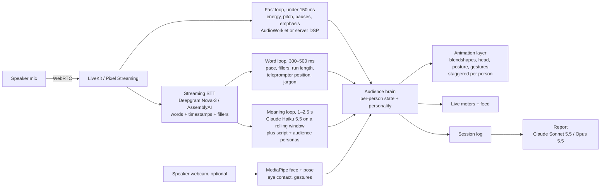

# Podium: from mockup to a hyper-realistic, real-time rehearsal room

## 1. What the prototype does now (and what it doesn't)

| Piece | In the prototype | Production target |
|---|---|---|
| Rooms | 5 built venues, plus **your own room from a photo**: the photo becomes the backdrop, Claude reads it (eye level, field of view, where the floor is, light direction, capacity) and the audience is seated to match, with shadows on the floor. Sliders fine-tune the fit. | A real 3D capture of the room (section 2.1) |
| People | 26 rigged, textured humans from Microsoft Rocketbox (MIT) | MetaHuman-grade digital humans |
| Body language | Real seated **motion capture** from Rocketbox (breathing, waiting, yawning, looking around, scratching heads, touching faces, thinking, coughing, shrugging) blended per person, with reactions layered on top: gaze toward you, eye saccades, blinks, nods on emphasis, brows, smiles, lean, phones, crossed arms, hand to chin, whispering, contagious yawns, applause | A captured library of real audience behaviour |
| Crowd model | Each person has attention, confusion and boredom. Boredom builds on dull delivery, faster for impatient people and tougher rooms; hooks win them back. Phones spread from neighbour to neighbour. **Brutal** mode: bore them for a few seconds and the phones come out | Same model, with weights fitted to real audiences |
| Curation | Pick who attends from a face grid, plus mood (Warm, Neutral, Tough, Brutal), topic knowledge, phones and a skeptic | Per-seat editor, saved crowds |
| Teleprompter | Follows your voice or auto-scrolls; import .txt, .md, .docx or .pdf | Same, plus pacing cues |
| Listening | Web Audio for volume, pitch and pauses; Web Speech API for words | Streaming STT plus a live LLM meaning loop (section 3) |
| Analysis | At the end only: score, key numbers, attention and confusion over time, moments (including when the first phone came out), next steps, and Claude's coaching, which now runs automatically | Same, plus video replay |

**How real is it?** The people read as real at a glance and move like real people because the motion is captured from real people. Up close they are still game-quality: hair is cards, skin has no subsurface scattering, and expressions come from a few face bones. Photo rooms are a flat backdrop, so people can't go behind furniture in the photo and you can't look around.

**Why Claude isn't reacting live yet:** the hosted page may only call Claude on a user action, not on a timer. So Claude reads your room photo when you add it and writes the coaching when you finish, and the live reactions run on local signals. The live meaning loop belongs on a server (section 3).

## 2. Making it photorealistic

### 2.1 The room: from one photo to a real 3D space
1. **Depth from the photo (next step, still in the browser).** Run a monocular depth model (Depth Anything V2 or Apple Depth Pro) on the uploaded photo. That gives the floor plane and per-pixel depth, so seats land on the real floor and people are hidden behind real desks and rows. This fixes the biggest giveaway today.
2. **A navigable room from one photo.** World Labs Marble turns a single image into a 3D Gaussian-splat world. Render it in the browser with Spark (World Labs' Three.js renderer) or in Unreal. The speaker can then look around and walk the stage.
3. **A true capture.** Ask for a 30-second phone video instead of a photo and reconstruct a Gaussian splat (Polycam, Luma or Scaniverse). This gives the most photoreal result: the room looks exactly like the room.
4. **Match the lighting.** Estimate an HDR light probe from the photo and light the avatars with it, so skin and clothes pick up the room's real light colour and direction. Today Claude only estimates a direction, warmth and brightness.

### 2.2 The people

#### Route A (recommended): Unreal Engine 5 + MetaHumans, streamed to the browser
- **Digital humans:** MetaHuman (Epic). Parametric faces, bodies, skin, hair, and clothing, so curation maps directly onto MetaHuman parameters. Facial rig uses ARKit-style blendshapes, so the reaction brain outputs curves like `browInnerUp`, `mouthSmile`, `headPitch`.
- **Crowd scale:** full MetaHumans in the first 2–3 rows. Further back, lower-LOD MetaHumans, or baked vertex-animation crowds driven by UE's Mass framework. 300 people at 60 fps is realistic on one cloud GPU if only the front rows get full facial animation.
- **Venues:** capture real rooms as Gaussian splats (Polycam, Luma, Scaniverse) and import them into UE5 through a 3DGS plugin, or generate them from a prompt or photo with World Labs Marble. Authored venues from the Fab marketplace work as a fallback. "Upload a photo of your actual conference room" is a strong feature.
- **Delivery:** Unreal Pixel Streaming (WebRTC) to the browser, on a cloud GPU (AWS G5/G6 or a managed host such as Arcware, PureWeb, or Vagon). The user's mic goes up the same WebRTC connection.
- **Trade-off:** best realism, but one GPU per concurrent user is the main running cost.

#### Route B: web-native (cheaper, less real)
- Three.js / React Three Fiber, with WebGPU where available.
- Gaussian-splat rooms in the browser with Spark (World Labs' Three.js splat renderer).
- Rigged glTF avatars (Reallusion Character Creator exports, or MetaHumans where the licence allows use outside Unreal) animated with the same blendshape curves.
- Runs on the user's own GPU, so it costs almost nothing per session. Looks a clear step below Route A.

#### Route C: photoreal video avatars for a featured panel
- Real-time talking-head services (Tavus, HeyGen LiveAvatar, Simli, Anam, D-ID) produce truly photoreal faces over WebRTC.
- Each stream is one person and is billed per minute, so they suit a **3–5 person interview panel or a Q&A moment**, not a 200-seat crowd.
- Good hybrid: crowd in Route A or B, plus a photoreal close-up when an audience member asks a question.

**Recommendation:** keep this repo as the testbed for the brain and analysis. Build the product renderer on Route A, with the room as a Gaussian splat from 2.1, and add Route C for interview panels.

### 2.3 Behaviour that matches real people
- **Capture real audiences.** Record real listeners with markerless motion capture (Move.ai or Rokoko Vision) and face capture (MetaHuman Animator or Live Link Face). Record them through good talks, boring talks and confusing ones, and build a clip library tagged by state. That is what makes the behaviour believable, more than any renderer.
- **Fit the brain to data.** Film real audiences during real talks, label attention cues (gaze on the speaker, phone use, posture, fidgeting) second by second, and fit the boredom and confusion weights so the simulated room reacts on the same timescale as real rooms.
- **Live meaning.** Run Claude on the server every few seconds over the live transcript (section 3), so people laugh at a joke that lands and look lost at an unexplained idea. Local acoustic signals can't detect either.
## 3. Making it react in real time

People in a real audience react 0.3–1.5 s after a cue, so the system needs three loops at different speeds:

| Loop | Latency | Signals | Audience behaviour it drives |
|---|---|---|---|
| Fast (acoustic) | < 150 ms | Loudness, pitch contour, pause length, stress peaks, uptalk | Nods on emphasis, heads lifting on a dramatic pause, drift on monotone |
| Word | 300–500 ms | Words per minute, fillers, repeated words, words since the last real pause, off-script detection, jargon list | Restlessness when rambling, struggling when you rush, phones coming out |
| Meaning | 1–2.5 s | An LLM reads the last ~20 s of transcript with the script and the crowd's profile. It returns `{clarity, confusion_reason, intrigue, humor, tangent, which_personas_react}` as JSON | Puzzled looks at an unexplained term, laughter at a joke that lands, sceptic shaking head at a weak claim |

### Tool choices for listening
- **Speech-to-text:** Deepgram Nova-3 streaming has word timestamps, interim results, and a `filler_words` option that keeps "um" and "uh", which matters here. Alternatives: AssemblyAI Universal-Streaming, Speechmatics, OpenAI realtime transcription.
- **Prosody:** compute pitch (YIN or CREPE), energy, and pause timing yourself in an AudioWorklet. It's cheap, private, and the fastest option. For vocal emotion (nervous, confident, flat), add Hume AI's streaming Expression Measurement, or openSMILE features on the server.
- **Meaning:** Claude Haiku 5.5 (`claude-haiku-5-5`) every 2–3 s with prompt caching on the script and personas, so each call only sends the new transcript slice. Use one call for the whole room that returns reactions per audience segment, not one call per person. Use Claude Sonnet 5.5 (`claude-sonnet-5-5`) or Opus 5.5 (`claude-opus-5-5`) for the end-of-session coaching report.
- **Speaker video (optional):** MediaPipe Face Landmarker and Pose in the browser for eye contact (are you looking at the room or the teleprompter?), posture, and hand gestures.
- **Transport:** LiveKit (WebRTC SFU plus its Agents framework) if Route B, or Pixel Streaming's own WebRTC if Route A.
- **Audience Q&A (stretch):** a persona-conditioned LLM writes the question, then streaming TTS (ElevenLabs, Cartesia) plus NVIDIA Audio2Face or the avatar service lip-syncs it.

## 4. The audience brain (already in the mockup, carries over unchanged)

Each person has a **personality**: warmth, patience, interest, expertise, phone habit, and a skeptic flag. They also have a **live state**: engagement, confusion, and valence. Every 250 ms:

1. Signals from the three loops update target engagement and confusion. Each person's own traits weight them: impatient people punish rambling harder, and newcomers are hit harder by jargon.
2. State eases toward the target at a personal rate, so the room doesn't move in lockstep.
3. Each person picks a behaviour (engaged, listening, drifting, checked out, on phone, confused) with hysteresis and a random hold time.
4. Discrete events (emphasis, a long pause, a jargon word) fire staggered micro-reactions with 150–750 ms of per-person delay.

For production, swap the procedural poses for an animation graph: blend spaces for posture, additive layers for nods and head tilts, and blendshape curves for the face. The brain stays the same.

## 5. Suggested build order

1. **Brain + analysis (done, this mockup).** Tune thresholds with recordings of real talks.
2. **Production listening:** Deepgram streaming + AudioWorklet prosody + the Claude meaning loop, behind one `signals` interface (the mockup's `addWord` / `addAudio` are that seam).
3. **Renderer:** UE5 project with 3 venues, a MetaHuman crowd generator driven by the curation JSON, and Pixel Streaming.
4. **Curation UI:** per-seat editor, saved crowds ("my board", "tough investors").
5. **Replay:** record the speaker's audio and video with the reaction timeline, and scrub through the moments.
6. **Q&A mode** and **interview panel** with photoreal video avatars.

## 6. Risks and open questions
- **Cost:** Route A needs a cloud GPU for every live session. Consider Route B for free tiers and Route A for paid tiers.
- **Uncanny valley:** subtle, staggered, slightly imperfect reactions read as more real than big expressive ones. Keep the animation understated.
- **Privacy:** speech and video are sensitive. Process prosody on the device, keep audio retention opt-in, and say plainly what is sent to STT and LLM providers.
- **Validation:** check that the room's reactions match what real audiences do. Record talks with real listeners rating them, and fit the brain's weights to those ratings.
- **Vendor details move fast:** confirm current pricing, licence terms (especially MetaHuman use outside Unreal), and API availability before committing.
