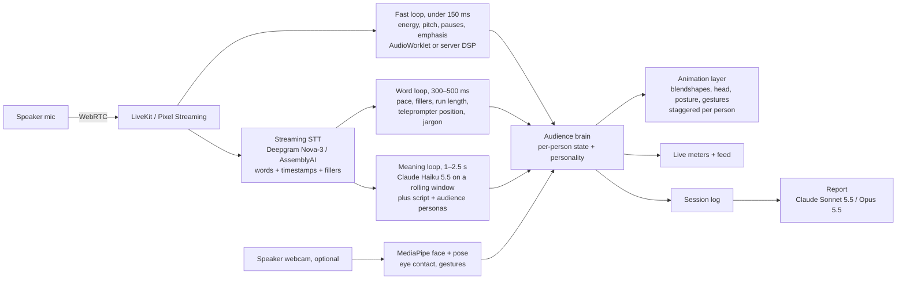

# Podium: from mockup to a hyper-realistic, real-time rehearsal room

## 1. What the mockup proves (and what it doesn't)

`index.html` is a single-file prototype of the full product loop:

| Piece | In the mockup | Production target |
|---|---|---|
| Room choice | 5 procedural venues (boardroom, classroom, lecture hall, keynote stage, banquet) | Photoreal captured or generated venues, plus the user's own room |
| Audience size | 3–300 seats, laid out for each venue | Same range, with LOD so 300+ stays real-time |
| Audience curation | Age mix, dress code, temperament, subject knowledge, phone habit, a front-row skeptic, reshuffle | Per-person editor: face, body, clothing, persona, plus saved "crowds" |
| Teleprompter | Overlay that follows your voice (fuzzy word matching with skip recovery) or auto-scrolls | Same, plus pacing cues ("pause here", "slow down") inline |
| Live listening | Web Audio for volume, pitch (autocorrelation) and pauses; Web Speech API for words | Streaming STT with word timestamps + prosody model + LLM meaning loop |
| Reactions | Per-person brain (engagement, confusion, patience, expertise) drives lean, nods on emphasis, head tilt and furrowed brows, phones, looking away, crossed arms, applause | Same brain driving full-body and facial animation on digital humans |
| Analysis | Live meters + feed, end-of-talk report with timeline, moments, and tips; optional Claude coaching inside claude.ai | Same, plus video replay with the room's reactions overlaid |

**What it does not do:** the people are stylised mannequins, not hyper-realistic humans. Photorealism takes a game-engine renderer and digital-human assets (section 2). The browser's speech recognition also drops "um" and "uh" fairly often, so filler counts run low. A production STT fixes that (section 3).

## 2. Making it look real: three rendering routes

### Route A (recommended): Unreal Engine 5 + MetaHumans, streamed to the browser
- **Digital humans:** MetaHuman (Epic). Parametric faces, bodies, skin, hair, and clothing, so curation maps directly onto MetaHuman parameters. Facial rig uses ARKit-style blendshapes, so the reaction brain outputs curves like `browInnerUp`, `mouthSmile`, `headPitch`.
- **Crowd scale:** full MetaHumans in the first 2–3 rows. Further back, lower-LOD MetaHumans, or baked vertex-animation crowds driven by UE's Mass framework. 300 people at 60 fps is realistic on one cloud GPU if only the front rows get full facial animation.
- **Venues:** capture real rooms as Gaussian splats (Polycam, Luma, Scaniverse) and import them into UE5 through a 3DGS plugin, or generate them from a prompt or photo with World Labs Marble. Authored venues from the Fab marketplace work as a fallback. "Upload a photo of your actual conference room" is a strong feature.
- **Delivery:** Unreal Pixel Streaming (WebRTC) to the browser, on a cloud GPU (AWS G5/G6 or a managed host such as Arcware, PureWeb, or Vagon). The user's mic goes up the same WebRTC connection.
- **Trade-off:** best realism, but one GPU per concurrent user is the main running cost.

### Route B: web-native (cheaper, less real)
- Three.js / React Three Fiber, with WebGPU where available.
- Gaussian-splat rooms in the browser with Spark (World Labs' Three.js splat renderer).
- Rigged glTF avatars (Reallusion Character Creator exports, or MetaHumans where the licence allows use outside Unreal) animated with the same blendshape curves.
- Runs on the user's own GPU, so it costs almost nothing per session. Looks a clear step below Route A.

### Route C: photoreal video avatars for a featured panel
- Real-time talking-head services (Tavus, HeyGen LiveAvatar, Simli, Anam, D-ID) produce truly photoreal faces over WebRTC.
- Each stream is one person and is billed per minute, so they suit a **3–5 person interview panel or a Q&A moment**, not a 200-seat crowd.
- Good hybrid: crowd in Route A or B, plus a photoreal close-up when an audience member asks a question.

**Recommendation:** prototype the brain and analysis on Route B (this repo), then build the product renderer on Route A. Add Route C for interview-panel and Q&A modes.

## 3. Making it react in real time

People in a real audience react 0.3–1.5 s after a cue, so the system needs three loops at different speeds:

| Loop | Latency | Signals | Audience behaviour it drives |
|---|---|---|---|
| Fast (acoustic) | < 150 ms | Loudness, pitch contour, pause length, stress peaks, uptalk | Nods on emphasis, heads lifting on a dramatic pause, drift on monotone |
| Word | 300–500 ms | Words per minute, fillers, repeated words, words since the last real pause, off-script detection, jargon list | Restlessness when rambling, struggling when you rush, phones coming out |
| Meaning | 1–2.5 s | An LLM reads the last ~20 s of transcript with the script and the crowd's profile. It returns `{clarity, confusion_reason, intrigue, humor, tangent, which_personas_react}` as JSON | Puzzled looks at an unexplained term, laughter at a joke that lands, sceptic shaking head at a weak claim |

### Tool choices for listening
- **Speech-to-text:** Deepgram Nova-3 streaming has word timestamps, interim results, and a `filler_words` option that keeps "um" and "uh", which matters here. Alternatives: AssemblyAI Universal-Streaming, Speechmatics, OpenAI realtime transcription.
- **Prosody:** compute pitch (YIN or CREPE), energy, and pause timing yourself in an AudioWorklet. It's cheap, private, and the fastest option. For vocal emotion (nervous, confident, flat), add Hume AI's streaming Expression Measurement, or openSMILE features on the server.
- **Meaning:** Claude Haiku 5.5 (`claude-haiku-5-5`) every 2–3 s with prompt caching on the script and personas, so each call only sends the new transcript slice. Use one call for the whole room that returns reactions per audience segment, not one call per person. Use Claude Sonnet 5.5 (`claude-sonnet-5-5`) or Opus 5.5 (`claude-opus-5-5`) for the end-of-session coaching report.
- **Speaker video (optional):** MediaPipe Face Landmarker and Pose in the browser for eye contact (are you looking at the room or the teleprompter?), posture, and hand gestures.
- **Transport:** LiveKit (WebRTC SFU plus its Agents framework) if Route B, or Pixel Streaming's own WebRTC if Route A.
- **Audience Q&A (stretch):** a persona-conditioned LLM writes the question, then streaming TTS (ElevenLabs, Cartesia) plus NVIDIA Audio2Face or the avatar service lip-syncs it.

## 4. The audience brain (already in the mockup, carries over unchanged)

Each person has a **personality**: warmth, patience, interest, expertise, phone habit, and a skeptic flag. They also have a **live state**: engagement, confusion, and valence. Every 250 ms:

1. Signals from the three loops update target engagement and confusion. Each person's own traits weight them: impatient people punish rambling harder, and newcomers are hit harder by jargon.
2. State eases toward the target at a personal rate, so the room doesn't move in lockstep.
3. Each person picks a behaviour (engaged, listening, drifting, checked out, on phone, confused) with hysteresis and a random hold time.
4. Discrete events (emphasis, a long pause, a jargon word) fire staggered micro-reactions with 150–750 ms of per-person delay.

For production, swap the procedural poses for an animation graph: blend spaces for posture, additive layers for nods and head tilts, and blendshape curves for the face. The brain stays the same.

## 5. Suggested build order

1. **Brain + analysis (done, this mockup).** Tune thresholds with recordings of real talks.
2. **Production listening:** Deepgram streaming + AudioWorklet prosody + the Claude meaning loop, behind one `signals` interface (the mockup's `addWord` / `addAudio` are that seam).
3. **Renderer:** UE5 project with 3 venues, a MetaHuman crowd generator driven by the curation JSON, and Pixel Streaming.
4. **Curation UI:** per-seat editor, saved crowds ("my board", "tough investors").
5. **Replay:** record the speaker's audio and video with the reaction timeline, and scrub through the moments.
6. **Q&A mode** and **interview panel** with photoreal video avatars.

## 6. Risks and open questions
- **Cost:** Route A needs a cloud GPU for every live session. Consider Route B for free tiers and Route A for paid tiers.
- **Uncanny valley:** subtle, staggered, slightly imperfect reactions read as more real than big expressive ones. Keep the animation understated.
- **Privacy:** speech and video are sensitive. Process prosody on the device, keep audio retention opt-in, and say plainly what is sent to STT and LLM providers.
- **Validation:** check that the room's reactions match what real audiences do. Record talks with real listeners rating them, and fit the brain's weights to those ratings.
- **Vendor details move fast:** confirm current pricing, licence terms (especially MetaHuman use outside Unreal), and API availability before committing.
